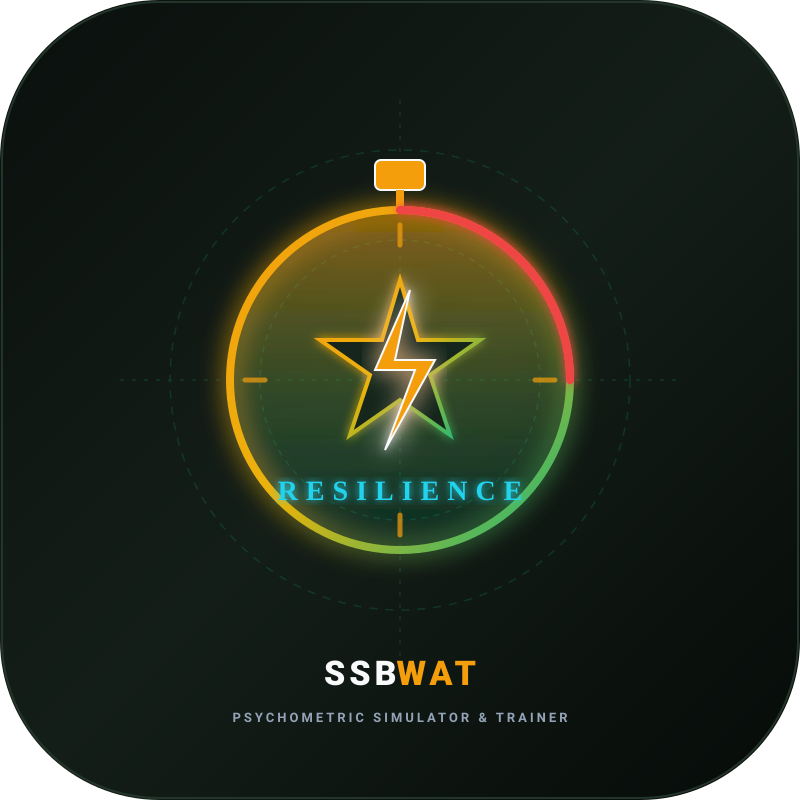
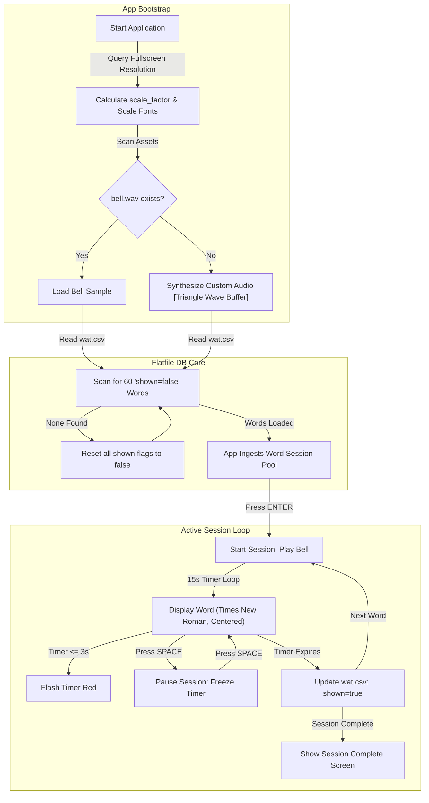

<p align="center">
  
</p>

<h1 align="center">SSB Word Association Test (WAT)</h1>

<p align="center">
  <strong>Immersive Fullscreen Pygame Simulator for Indian Armed Forces SSB Psychological Evaluations.</strong>
</p>

<p align="center">
  <a href="LICENSE"></a>
  
  
  
  <a href="future.md"></a>
</p>

---

## ⚡ Overview

The **SSB Word Association Test (WAT) Simulator** is a distraction-free, fullscreen desktop trainer engineered to **reproduce the intense psychological testing conditions** of the Indian Armed Forces (Army, Navy, Air Force) selection process.

Under strict 15-second time constraints, candidates are presented with a series of 60 words in rapid succession and must spontaneously record constructive, action-oriented responses without conscious filtering.

---

## 🏛️ Application State & Game Loop



---

## ⚡ Core Technical Pillars

### 1. Aspect-Ratio Sensitive Typography Engine
To maintain high-fidelity layouts across diverse displays (from 1080p notebooks to 4K desktop screens), the application dynamically queries system metrics on startup:
```python
SCALE_FACTOR = min(SCREEN_WIDTH / 1024, SCREEN_HEIGHT / 768)
FONT_SIZE = int(BASE_FONT_SIZE * SCALE_FACTOR)
```
This scale factor dynamically recalculates all text bounding boxes, font heights, and vertical grid offsets, guaranteeing that the central word remains crisp and prominent.

### 2. Programmatic Audio Synthesis Fallback
If the physical `bell.wav` file is absent, the system does not crash or fail silently. It falls back to an **on-the-fly digital signal synthesizer** using Python's audio array buffer:
*   Generates a custom triangle wave frequency array at $22050\text{ Hz}$ sampling rate.
*   Applies a mathematically mapped linear volume envelope fade to emulate the decay profile of a real bell.
*   Injects a custom audio array into `pygame.sndarray.make_sound` to output clear, hardware-independent audio tones.

### 3. Persistent Flat-File State Database
Saves test progress natively using a CSV flat-file (`wat.csv`) acting as a state database:
*   **Progressive Loading:** Every session selectively parses the sheet to extract the next 60 unshown words.
*   **Real-time Saves:** At the exact second a word's timer expires, the script modifies the specific file line in `wat.csv`, toggling `shown` to `true`.
*   **Auto-Recycling:** When the entire word database is exhausted, the app triggers a complete table scan, resetting all flags back to `false` automatically.

### 4. Precision Timer & Pause Stack
Maintains sub-millisecond timer accuracy by tracking physical time deltas via `time.time()` rather than relying on frame-rate-dependent ticks, ensuring consistent pacing even during frame drops.

---

## 🕹️ Controls & Navigation

*   <kbd>ENTER</kbd> : Start / Resume a test session from the menu screens.
*   <kbd>SPACEBAR</kbd> : Toggle pause / resume during an active test to inspect sentences.
*   <kbd>ESCAPE</kbd> : Instantly exit the fullscreen application.

---

## 🚀 Quick Start (Under 10 Seconds)

### 1. Clone the Repository
```bash
git clone https://github.com/seeramsujay/Word-Association-Test-SSB-.git
cd Word-Association-Test-SSB-
```

### 2. Install Pygame Engine
```bash
pip install -r requirements.txt
```

### 3. Launch the Simulator
Run the main script to start your training session:
```bash
python wat.py
```

### 4. Customizing the Word Pool
Open `wat.csv` in any spreadsheet or text editor to append your own words:
```csv
word,best_response,shown
RESILIENCE,Resilience helps overcome setbacks,false
STRATEGY,A good strategy ensures success,false
```

---

## 🔮 Engineering Roadmap

To explore planned features including WebAssembly (Wasm) Pygbag browser ports, real-time voice dictation, and AI Officer Like Quality (OLQ) psychological scoring, read [future.md](future.md).

---

## 📄 License

This project is licensed under the **MIT License**. See [LICENSE](LICENSE) for details.
